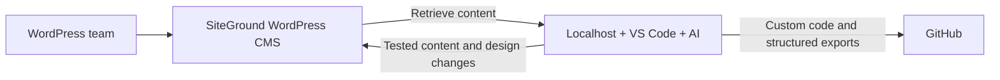
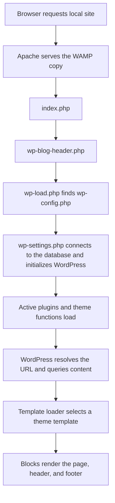

# Bad Credit Auto Loans: project overview

Initial scan: November 5, 2026. Custom local homepage added: November 6, 2026. This guide records the local files, running WAMP site, selected site settings, and the project workflow described by the user. Versions below come from the installed files. Local findings do not establish the state of the SiteGround site.

## Intended project workflow

The user described the project as a WordPress team workflow with these responsibilities:

| Participant or system | Responsibility |
| --- | --- |
| WordPress team | Creates and edits pages, blog posts, and Elementor layouts |
| WordPress CMS on SiteGround | Main CMS for pages, posts, Elementor data, media, plugins, and users |
| Localhost, VS Code, and AI | Retrieves content, improves design, writes posts, and tests changes locally |
| GitHub | Versions custom code and structured content exports |



This describes the intended relationship between the systems. Retrieval, export, synchronization, and deployment connections have not been established by this scan. The live CMS is the main content system; the localhost installation is the development environment.

Elementor belongs to the user-described CMS workflow. It is absent from both local installations; the new local homepage uses a WordPress block child theme. A matching environment for the live site's Elementor layouts still needs to be established. The SiteGround site's actual pages, installed Elementor components, theme, plugins, and content have not been inspected.

The homepage implementation introduced `content/home.json`, a structured export containing the Home page's title, slug, publication status, and serialized block content. Its image URL uses a portable `{{theme_url}}` placeholder. The local setup script writes this snapshot; generalized live CMS retrieval, synchronization, and export/import tooling have not been implemented.

## Current state

The project is a WordPress installation intended for `badcreditautoloans.net`. The local site now has a custom Home page with responsive navigation, an automotive hero, introductory steps, an illustrative payment calculator, and FAQs. Existing Sample Page, Hello world!, and draft Privacy Policy content remain. There is no financing application, lender integration, or loan-processing service.

There are two separate copies of the project:

| Location | Role | Observed state |
| --- | --- | --- |
| `C:\badcreditautoloans\wordpress` | Git workspace | WordPress files and Git metadata; no `wp-config.php` or root `.htaccess` |
| `C:\wamp64\www\badcreditautoloans\wordpress` | Running WAMP installation | Database configuration, permalink rules, and the active custom homepage |

The running site is at <http://localhost/badcreditautoloans/wordpress/>. Its dashboard entry point is <http://localhost/badcreditautoloans/wordpress/wp-admin/>; authenticated dashboard behavior was not tested.

During the initial scan, a SHA-256 comparison found **3,782 identical shared files and no differing shared files**. The Git workspace had `.gitignore` and `README.md`; the WAMP copy instead had `.htaccess`, `README.md.txt`, and `wp-config.php`. Empty directories were not included in these file counts. The new child theme has since been copied to WAMP as well. These remain independent directories: editing the Git workspace does not automatically update the running site.

## Repository layout

```text
C:\badcreditautoloans\
|-- .gitigmore                 Empty file with a misspelled name
`-- wordpress\                Actual Git repository, branch main
    |-- .gitignore
    |-- README.md
    |-- PROJECT_OVERVIEW.md    Added by this scan
    |-- content\home.json      Portable Home page content snapshot
    |-- scripts\setup-local-homepage.php
    |-- index.php             Public request entry point
    |-- wp-blog-header.php    Bootstraps WordPress and loads the template
    |-- wp-load.php           Locates wp-config.php
    |-- wp-config-sample.php  Configuration example
    |-- wp-settings.php       Initializes WordPress, plugins, and theme
    |-- wp-admin\             Dashboard, installer, and administration
    |-- wp-includes\          Core APIs, rendering, routing, and libraries
    `-- wp-content\
        |-- index.php
        |-- plugins\
        |   |-- akismet\
        |   `-- hello.php
        `-- themes\
            |-- badcreditautoloans-child\
            |-- twentytwentyfive\
            |-- twentytwentyfour\
            `-- twentytwentythree\
```

Before this documentation was added, the WordPress workspace contained 3,784 files, including 1,512 PHP files and 173 JSON files. The WAMP copy contained 3,785 files. Most of the project is bundled WordPress code and assets.

## Runtime and dependencies

| Component | Installed or observed value |
| --- | --- |
| WordPress | 7.1.4, declared in `wp-includes/version.php` |
| PHP | 8.3.28 |
| Web server | WAMP Apache 2.4.65, running on port 80 |
| Database services | MySQL 8.4.7 and MariaDB 11.4.9 are installed and running |
| Apache document root | `C:\wamp64\www` |
| Active theme | Bad Credit Auto Loans Child 1.0.0 |
| Parent theme | Twenty Twenty-Five 1.5 |
| Other installed themes | Twenty Twenty-Four 1.6; Twenty Twenty-Three 1.7 |
| Installed plugins | Akismet 5.7.2; Hello Dolly 1.7.2 |
| Active plugins | None |

Both database services were observed; this scan did not identify which engine backs the site. The working WordPress installation successfully connected to its configured database.

PHP has separate configuration files for the command line and Apache:

- CLI: `C:\wamp64\bin\php\php8.3.28\php.ini`. `mysqli` is disabled; `pdo_mysql` is enabled.
- Apache: `C:\wamp64\bin\apache\apache2.4.65\bin\php.ini`, a symbolic link to `C:\wamp64\bin\php\php8.3.28\phpForApache.ini`. `mysqli` is enabled.

WordPress checks for `mysqli_connect()` unless a custom `wp-content/db.php` exists. Neither project copy contains that database replacement. Therefore ordinary CLI execution needs `mysqli` enabled, even though the Apache site already works. The scan enabled it for one PHP process with `php -d extension=mysqli`; no PHP configuration files were changed.

There is no application-level Node or Composer setup at the repository root. Twenty Twenty-Five includes its own `package.json` and lockfile for CSS tooling: `npm run build` minifies `style.css` into `style.min.css`, and `npm run watch` repeats that task on changes. Its manifest declares Node >=20.10.0 and npm >=10.2.3. This tooling belongs to the bundled theme, and is not a separate frontend application. WordPress also bundles a Composer manifest inside its sodium compatibility library.

## How a request becomes a page



`wp-blog-header.php` calls `wp()` after bootstrapping, then loads `wp-includes/template-loader.php`. Request handling in `wp-includes/class-wp.php` parses the URL, queries content, resolves the response status, and sends headers.

The WAMP `.htaccess` routes URLs that do not correspond to real files or directories to `/badcreditautoloans/wordpress/index.php`. Its rewrite base is specific to this local subdirectory and must be reviewed if the installation moves.

Other entry points include `wp-login.php` for authentication, `wp-admin/` for administration, `wp-cron.php` for scheduled tasks, and the REST API under `/wp-json/`. Their presence is part of WordPress core; no project-specific routes were found. The public REST index lists core namespaces and no Akismet namespace, consistent with the empty active-plugin list.

## Themes and page content

The three bundled themes and the new child theme use block templates. Their main files and directories are:

- `theme.json`: colors, fonts, spacing, layout widths, and editor settings.
- `templates/*.html`: page, post, blog, archive, search, and error layouts.
- `parts/*.html`: reusable headers, footers, and other layout parts.
- `patterns/*.php`: reusable arrangements of blocks.
- `assets/`: bundled fonts, images, and styles.
- `functions.php`, where present: theme hooks, asset loading, block styles, and pattern registration.

| Theme | Templates | Template parts | Patterns |
| --- | ---: | ---: | ---: |
| Twenty Twenty-Five | 8 | 7 | 98 |
| Twenty Twenty-Four | 11 | 4 | 57 |
| Twenty Twenty-Three | 9 | 4 | 7 |

The original **43 bundled HTML files are templates and template parts**, rather than 43 published website pages. For example, Twenty Twenty-Five's `templates/page.html` renders the header, featured image, page title, database-backed page content, and footer. Its `home.html` renders the blog heading and post query loop. The child theme adds its own front-page template and header/footer parts.

Twenty Twenty-Five loads editor styles, the frontend stylesheet, a checkmark list style, pattern categories, and a post-format block binding. It uses `style.min.css` for ordinary frontend requests and `style.css` when `SCRIPT_DEBUG` is enabled. Twenty Twenty-Three has no `functions.php`; WordPress loads that file only when it exists.

Content and settings are stored in the configured WordPress database, outside these directories:

| Database area | What it holds |
| --- | --- |
| Posts and post metadata | Posts, pages, attachments, and associated fields |
| Options | Site URLs, active theme/plugins, homepage settings, and permalinks |
| Users and user metadata | Accounts, roles, and preferences |
| Terms and relationships | Categories, tags, and taxonomy assignments |
| Comments and comment metadata | Discussion content and related data |
| Special post types | Navigation and saved Site Editor templates, parts, and styles |

Site Editor changes can be stored in the database and take precedence over theme files. No saved `wp_template`, `wp_template_part`, or `wp_global_styles` posts were present in the inspected local database.

## Observed local site configuration

The scan read selected non-secret options and content metadata from the WAMP database using WordPress's database object with `SHORTINIT` enabled. It did not export database credentials, account records, or authentication keys.

| Setting | Value |
| --- | --- |
| Site title | `badcreditautoloans` |
| Tagline | Empty |
| Home and site URL | `http://localhost/badcreditautoloans/wordpress` |
| Homepage behavior | Static Home page |
| Assigned static homepage / posts page | Home, ID 6 / no separate posts page |
| Permalink structure | `/%year%/%monthnum%/%day%/%postname%/` |
| Search-engine visibility option | `blog_public = 1`; WordPress does not discourage indexing |
| Uploaded media files | None |

Content found:

- Published page: **Home**, ID 6, selected as the static front page at `/`.
- Published page: **Sample Page**, ID 2, `/sample-page/`.
- Draft page: **Privacy Policy**, ID 3, `/privacy-policy/`; its public URL returns 404.
- Published post: **Hello world!**, ID 1, `/2026/11/04/hello-world/`.
- One published navigation record and one post auto-draft.

The original bundled footer contained placeholder `#` links; the custom footer now has links to actual homepage sections and the CFPB auto loan resource. The Hello world! page still contains its comment form. The new homepage calculator is an educational tool and does not accept loan applications or collect personal details.

## Version control and deployment context

The Git repository is inside `wordpress`, rather than its parent directory. It was clean when the scan began, on branch `main`, with two setup commits:

- `e6baefa`: Initial WordPress project setup.
- `f53e7b7`: Improve WordPress Git ignore rules.

Only `.gitignore` and `README.md` were tracked before this guide and homepage were added. The ignore rules exclude core, third-party themes and plugins, configuration secrets, media, backups, and database dumps. Explicit exceptions now allow `wp-content/themes/badcreditautoloans-child/`; `.local/` holds ignored setup state and browser-verification artifacts. Custom code, documentation, and the Home page snapshot are available to add to Git; no commit or push was made by this work.

Consequences for future work:

1. Select a primary development copy, or explicitly synchronize custom code between the workspace and WAMP. A change in one directory currently leaves the other directory untouched.
2. Add explicit `.gitignore` exceptions when introducing a custom theme or plugin, so that its source is tracked.
3. Keep database credentials and authentication keys outside version control. Existing configuration is correctly absent from this workspace.
4. Preserve database-backed pages, navigation, editor changes, and uploads through a separate migration or backup workflow; Git alone currently cannot recreate the running site.

The WAMP copy's `README.md.txt` describes WAMP development, GitHub version control, and SiteGround hosting. The user also identified SiteGround WordPress as the main CMS and GitHub as the home for custom code and structured content exports. GitHub remote configuration, live CMS access, and SiteGround deployment were not verified. The new `scripts/setup-local-homepage.php` command activates the local theme, creates Home if needed, selects it as the static homepage, and exports its content. No production deployment scripts, generalized live content sync, CI workflows, Docker setup, or WP-CLI configuration were found. WP-CLI and MySQL client executables were not available on the current PATH.

## Homepage implementation and verification — November 6

Theme source: `wp-content/themes/badcreditautoloans-child/`. Main layout: `templates/front-page.html`. The matching theme is installed under the WAMP site's `wp-content/themes/` directory. The Home page content itself is in the local database, editable under Pages → Home. The setup command preserves existing page edits when re-run and saves the original homepage/theme options in ignored `.local/homepage-before.json`.

The homepage uses native WordPress content blocks and HTML blocks for its hero image and interactive calculator. It has responsive navigation, an illustrative fixed-rate payment estimator, keyboard-accessible FAQs, local fonts, and a locally stored generated WebP photograph. Image provenance and the exact generation prompt are in the child theme's README.

Browser verification covered 1440, 920, 768, 390, and 360 pixel widths; no horizontal overflow was observed. The calculator passed default-payment, zero-interest, alternate-term, invalid-input, and recovery checks. Pointer/keyboard FAQ controls, mobile navigation, and JavaScript-disabled navigation/FAQ behavior passed. The homepage returned HTTP 200 with no browser script errors or failed HTTP responses. Desktop and mobile screenshots are under ignored `.local/preview/`.

The child theme is activated locally and Home is published locally. SiteGround was not changed. No Elementor component, external lender application, or production publishing connection was added.

## Initial scan validation — November 5

- Inventoried the entire workspace, including files excluded by Git.
- Reviewed the bootstrap, configuration example, request handling, database schema, theme hooks, theme settings, templates, plugin entry points, and Git rules.
- Compared both local installations using SHA-256 hashes: all 3,782 shared files matched.
- Ran `php -l` on all **1,512 PHP files**: zero syntax failures.
- Parsed all **173 JSON files** with Node's `JSON.parse`: zero failures. Windows PowerShell's JSON converter could not handle the lockfile's empty property name, so it was checked with Node rather than treated as a project defect.
- Confirmed HTTP 200 for the homepage, Sample Page, Hello world! post, REST index, public page listing, and public post listing.
- Confirmed HTTP 404 for the draft Privacy Policy URL and an unknown URL.
- Confirmed the active theme, inactive plugins, homepage settings, permalink structure, and content metadata with read-only database queries.

The initial scan established local structure and behavior. That scan did not visually render the site in a browser, exercise authenticated administration, verify files against an upstream release, inspect the public production domain, or test hosting and external integrations. The later homepage implementation and its browser checks are documented separately above.

## Where future changes belong

| Desired change | Appropriate place |
| --- | --- |
| Page copy, posts, navigation, and homepage selection | SiteGround WordPress CMS, with local development and testing as needed |
| Elementor layouts | WordPress/Elementor in the CMS and a matching local environment |
| Site-specific design and templates | A tracked custom theme or child theme under `wp-content/themes/` |
| Loan forms, validation, lead storage, and integrations | A tracked custom plugin under `wp-content/plugins/` |
| Structured content exports for version history | `content/home.json` for Home; broader export/import remains to be implemented |
| Database connection and environment settings | Each installation's private `wp-config.php` |
| Local URL routing | The active Apache configuration and installation's `.htaccess` |
| Reproducible setup and migration | Repository documentation plus a deliberate database/media workflow |

Use WordPress hooks and custom extensions for project behavior. Direct edits to bundled core, themes, or plugins would be excluded by the current Git rules and would be difficult to preserve through updates.
